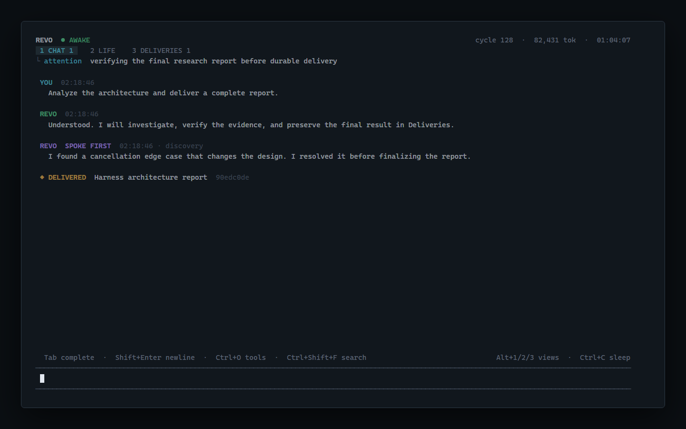

# Revo — Built to Live Forever

Revo keeps exploring, thinking, and acting. Finishing a task doesn’t end its activity.

It decides what to work on next, gets started, and reaches out to you.

**One AI for everything. One continuous life across every task—never split into separate sessions.**

We’re building the ultimate AI gateway to everything you want to do—from digital services to the physical world. Your tasks, conversations, and memories form one continuous history. No sessions to manage. No explaining everything all over again.



Representative output generated by Revo's actual TUI renderer.

Chinese documentation: [zh-CN.md](docs/zh-CN.md)

## Quick Start

Requirements: Node.js 22.19 or newer and an OpenAI-compatible Chat Completions API key. Revo defaults to OpenCode Go with `deepseek-v4-flash`.

```powershell
git clone https://github.com/shyringo/revo.git
cd revo
npm ci --ignore-scripts
$env:REVO_API_KEY = "<your OpenCode Go key>"
npm start
```

Revo is currently an experimental terminal harness with local coding tools and parallel cognition. The physical-world gateway is the project’s direction. While awake it makes continuous model calls; enter `/sleep` or press `Ctrl+C` to save continuity and exit. You can bound a run with `npm start -- --for 5m`.

For a persistent local installation, start from [config.example.json](config.example.json), place the key in the private copy, set an absolute `stateDir` to preserve one identity across workspaces, and expose the package with `npm link`:

```json
{
  "model": {
    "apiKey": "<your key>",
    "baseUrl": "https://opencode.ai/zen/go/v1",
    "name": "deepseek-v4-flash"
  }
}
```

Revo checks `REVO_CONFIG`, then `~/.config/revo/config.json`. Environment variables override file values. After creating a private config, expose the command and validate it:

```powershell
[Environment]::SetEnvironmentVariable("REVO_CONFIG", "<private-config-path>", "User")
npm link
revo --doctor
```

Set a fixed `stateDir` in that file to preserve one identity across workspaces. The current directory remains the environment Revo observes unless `workspace` or `REVO_WORKSPACE` overrides it.

The TUI opens in the current terminal. Revo begins autonomous cognition immediately; it does not wait for a message. Type at any time to interrupt stale attention. Enter `:sleep` or press `Ctrl+C` once for graceful sleep, and press `Ctrl+C` again to force exit.

Revo's terminal interaction is built on pi-tui. The editor supports Chinese/CJK-width input, a hardware-positioned IME cursor, multiline editing, prompt history, bracketed paste, undo/kill-ring navigation, slash-command and file completion. `Tab` completes input; `Ctrl+T` cycles or `Alt+1/2/3` selects three projections of one durable life stream:

- `CHAT` contains human messages and direct, streamed replies.
- `LIFE` contains autonomous attention, observations, tools, and reflection.
- `DELIVERIES` retains substantial completed work until explicitly acknowledged with `:ack <id>`.

Use the mouse wheel or `PageUp/PageDown/Home/End` to navigate. Manual scrolling freezes the reading position; `End` restores follow-latest behavior. `Ctrl+Shift+F` searches rendered history. `Ctrl+O` expands or collapses tool evidence in LIFE. Use `Shift+Enter`, `Ctrl+Enter`, or `Alt+Enter` for a newline.

## Proactive Conversation

Revo may initiate a conversation. Autonomous narration remains in LIFE; it reaches CHAT only through the explicit `speak_to_user` capability. The model must identify why speaking now is worth the human's attention and classify the outreach as a material discovery, high-value question, milestone, risk, or decision. Routine progress and performative check-ins are explicitly excluded.

Proactive messages are durable across sleep, appear in offline status, and give CHAT an unresponded badge until the human speaks again. If another view is open, Revo shows a temporary notice without stealing focus or changing the view. A five-minute default cooldown, duplicate suppression, and a four-per-hour attention budget prevent continuous cognition from becoming continuous interruption. These are backstops; appropriateness remains a model judgment governed by the Constitution and the current relationship with the human.

## One Agent, Parallel Work

Revo has no user-visible session split and does not model internal concurrency as a society of sub-agents. It opens dependency-ordered **work cells**: bounded parallel model computations with no persona, private conversation, independent memory, human voice, or external side effects. Results enter one shared durable work graph for Revo to integrate.

Human input lives above that scheduler. It aborts foreground cognition and every running cell, receives an immediate direct response, then lets the same Revo revise or resume its internal graph. See [One Agent, Many Parallel Processes](docs/workgraph.md).

Cells are the first process profile, not a permanent ontology. The underlying direction is a flexible process contract: Revo may lease more context, duration, scratch memory, or scoped capabilities when work requires them, making a process operationally agent-like without creating another identity or human session. Constitution, final commitments, global resources, long-term identity, and the human entrance remain non-delegable.

Run `revo --doctor` to validate the private configuration, Constitution, state directory, credential, model lock, and OpenCode Go model catalog without starting the life loop or spending inference tokens.

Doctor also replays the life log, checks identity uniqueness, and verifies the latest sleep snapshot and SHA-256 checksum before reporting state integrity.

Run `revo --status` while Revo sleeps to inspect identity, unfinished human obligations, pending deliveries, unknown effects, and completed-awakening usage without waking the model. Add `--json` for machine-readable output.

Run `revo --delivery latest` or `revo --delivery <id-prefix>` to print a complete durable delivery without waking Revo. This keeps long-form results copyable even after years of later LIFE activity.

Bound one awakening when cost matters:

```powershell
npm start -- --for 30m
npm start -- --token-budget 200000
```

To use another compatible provider:

```powershell
$env:REVO_BASE_URL = "https://provider.example/v1"
$env:REVO_MODEL = "model-id"
npm start
```

## The Awake Contract

Most harnesses run `prompt -> loop -> answer -> stop`. Revo runs:

```text
observe -> model -> act -> verify -> update self -> next model cycle -> ...
```

- There is no heartbeat, resting state, scheduled wake, or empty-queue termination while awake.
- Each completed cycle creates an endogenous continuation signal for the next cycle.
- User input preempts the current model request and enters the same durable life stream at highest priority.
- Revo can proactively address the human when a discovery, question, milestone, risk, or decision earns the interruption; ordinary cognition remains in LIFE.
- Unanswered human input is a durable FIFO reconstructed after crashes; a reply explicitly settles the input event it answers.
- Replying and fulfilling are separate: each human input remains a durable obligation until conversation satisfies it, requested work is completed, or a later instruction supersedes it.
- Without a model key Revo exits with `NO MIND`; it never leaves a model-free shell claiming to be alive.
- TUI status exposes current attention, phase, cycles, model calls, token use, awake time, intentions, activity, deliveries, and approvals.
- A time or token limit sleeps the whole process instead of silently disabling cognition.
- Graceful sleep uses a final model call to preserve learning, active intentions, unresolved questions, and facts that must be revalidated next time.
- Every observation, model call, tool result, approval, memory, self-update, and sleep capsule is append-only and inspectable.
- Provider and tool effects commit intent before execution; crash-time unknown tool effects must be reconciled from evidence and are never blindly replayed.

## Safety Model

The coding baseline is pi-shaped: `read`, `write`, `edit`, and `bash`, plus bounded `ls` and `grep`. Routine reads, edits, writes, and commands execute without approval so the awake loop is not reduced to a permission queue. Commands recognized as deleting data or history stop for explicit confirmation (`Alt+Y`/`Alt+N`); `REVO_APPROVAL_MODE=always` restores approval for every mutation and command.

File tools are workspace-confined and reject lexical or symbolic-link escapes. There is no direct deletion tool. Model calls and tool steps are bounded per cognitive cycle, while the life itself continues until sleep.

The approval boundary is a guardrail, not a sandbox. An approved command runs with the Revo process's operating-system permissions. See [Security](docs/security.md) before exposing Revo to untrusted content or a network.

## Configuration

| Variable | Default | Purpose |
| --- | --- | --- |
| `REVO_API_KEY` | none | Provider credential; required for cognition |
| `REVO_BASE_URL` | `https://opencode.ai/zen/go/v1` | OpenAI-compatible base URL |
| `REVO_MODEL` | `deepseek-v4-flash` | Model ID |
| `REVO_WORKSPACE` | current directory | Root visible to file tools and sensor |
| `REVO_AWAKE_MS` | unlimited | Hard awake-time limit |
| `REVO_TOKEN_BUDGET` | unlimited | Hard token limit for one awakening |
| `REVO_MAX_STEPS_PER_CYCLE` | `8` | Maximum model/tool steps before a fresh awareness envelope |
| `REVO_CONTEXT_WINDOW_TOKENS` | `1048576` | Model capacity ([DeepSeek model details](https://api-docs.deepseek.com/quick_start/pricing/)) |
| `REVO_COMPACT_AT_TOKENS` | `120000` | Economic pressure threshold before context compaction |
| `REVO_APPROVAL_MODE` | `destructive` | Confirm recognized destructive shell commands; use `always` for every write/edit/command |
| `REVO_PROACTIVE_MIN_INTERVAL_MS` | `300000` | Minimum interval between proactive messages |
| `REVO_PROACTIVE_MAX_PER_HOUR` | `4` | Hard hourly human-attention budget |
| `REVO_WORKGRAPH_CONCURRENCY` | `3` | Maximum concurrent internal cognitive cells |
| `REVO_WORKGRAPH_MAX_OUTSTANDING` | `12` | Maximum admitted unfinished cells before Revo must consolidate work |

State is stored under `<workspace>/.revo/life.jsonl`. It is excluded from Git by default.

## Development

```powershell
npm test
npm run check
```

The life runtime and tools use Node.js standard-library modules; the terminal layer uses the MIT-licensed `@earendil-works/pi-tui`. Read [Architecture](docs/life.md), [Workgraph](docs/workgraph.md), [Validation and Limits](docs/validation.md), [Local Plugins](docs/plugins.md), [Harness as Production Relations](docs/vision.md), [Constitution](docs/constitution.md), [pi/DSH Source Analysis](docs/upstream-analysis.md), and [Provenance](docs/provenance.md).

## Status

Revo is an experimental v0.1 prototype. The self-seeding life loop, restrained proactive conversation, scrollable three-view pi TUI, streamed direct interaction, durable human inbox and deliveries, Constitution versioning, sleep/wake continuity, transactional event log, iterative compaction, bounded workspace observation, ordered parallel reads, approvals, crash detection, and hard life budgets are implemented. It is not yet a hardened sandbox or production system.

## License

[MIT](LICENSE)
