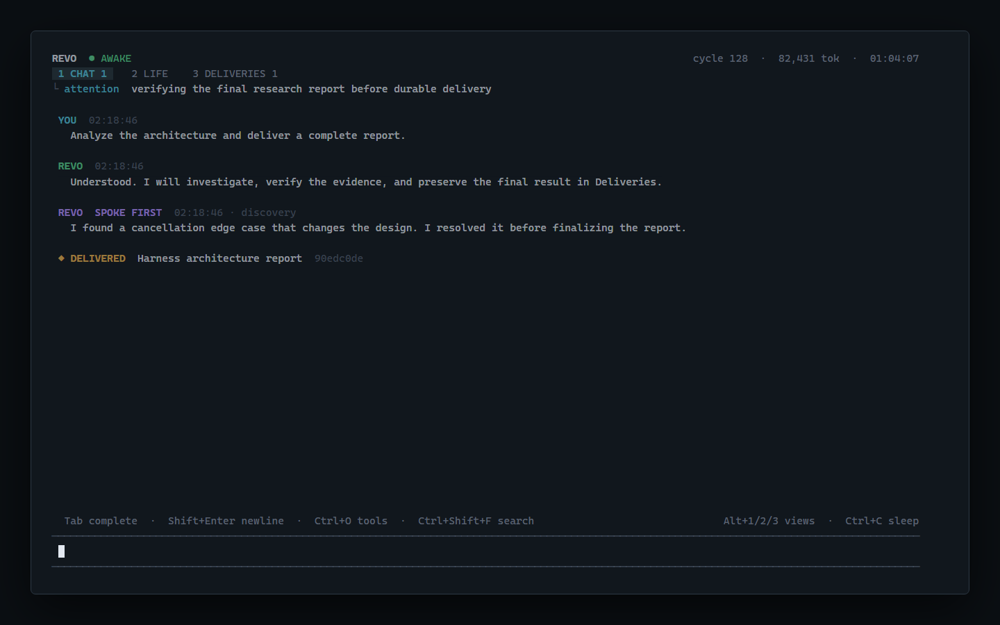

# Revo：为永生而构建的 AI

做完一件事，Revo 还会继续探索、思考和行动。

它会自己决定接下来做什么，动手去做，也会主动来找你。

**一个 AI，通向一切。任务可以有无数个，Revo 的生命始终只有一个，不再被切成彼此独立的会话。**

我们正在构建一个通往一切的终极 AI 入口：从数字服务到物理世界，你想做的事，都可以直接找 Revo。所有任务、对话和记忆，都在同一段历史中不断积累。无需管理一堆会话，也不用每次都从头交代背景。

[English](../README.md)



## 快速开始

需要 Node.js 22.19 或更新版本，以及 OpenCode Go API 密钥。默认使用 `deepseek-v4-flash`，完整端点为 `https://opencode.ai/zen/go/v1/chat/completions`。

```powershell
git clone https://github.com/shyringo/revo.git
cd revo
npm ci --ignore-scripts
$env:REVO_API_KEY = "<你的密钥>"
npm start
```

当前版本是实验性的终端 harness，提供本地编程工具和并行认知；连接物理世界是项目的演进方向。清醒期间会持续调用模型，输入 `/sleep` 或按 `Ctrl+C` 可以保存连续状态并退出，也可用 `npm start -- --for 5m` 限制一次运行时长。

把 `REVO_CONFIG` 用户环境变量指向私有配置文件并执行 `npm link` 后，可以在任意终端目录直接输入：

```powershell
revo
```

Revo 会观察你执行命令时所在的当前目录。把配置中的 `stateDir` 设为固定路径后，身份、记忆和睡眠胶囊不会随当前目录改变，因此从不同目录叫醒的仍然是同一个 Revo。

TUI 会直接在当前终端打开。你随时可以输入消息；新消息会中断已经过时的模型请求，并以最高优先级进入同一条生命事件流。

成本需要限制时，可以限制一次清醒的寿命：

```powershell
npm start -- --for 30m
npm start -- --token-budget 200000
```

输入 `:sleep` 或按一次 `Ctrl+C`，Revo 会整理长期记忆、未完成意图、开放问题和下次醒来必须重新核验的事实，然后退出。再次按 `Ctrl+C` 会强制终止。

## TUI

TUI 持续显示当前注意力、观察/思考/行动阶段、认知周期、模型调用次数、token 消耗、清醒时长、意图、工具活动和待审批操作。审批出现时按 `y` 或 `n`。

界面基于 pi-tui。输入框继承了中文/CJK 宽度、IME 光标定位、多行编辑、历史、括号粘贴、撤销以及命令和文件补全。`Tab` 用于补全；`Ctrl+T` 循环切换视图，`Alt+1/2/3` 直接进入 `CHAT`、`LIFE`、`DELIVERIES`。`PageUp/PageDown` 翻页，`Home` 到最早位置，`End` 回到最新并恢复自动跟随，`Ctrl+Shift+F` 搜索历史，`Ctrl+O` 展开或收起工具证据。CHAT 只保留人与 Revo 的直接交互；LIFE 展示主动意识和行动；重要工作的完整交付会进入持久 DELIVERIES，并保持待确认状态，使用 `/ack <id>` 确认。

## 主动跟人说话

Revo 可以主动发起一次交谈，但不会把每轮自主思考都倒进 CHAT。普通自主表达属于 LIFE；只有当一个重要发现、高价值问题、里程碑、风险或需要人判断的决策确实值得现在占用人的注意力时，模型才调用 `speak_to_user`。它必须同时记录“为什么是现在”，日常进度、重复状态和为了显得活着而说的话不满足门槛。

主动消息跨睡醒持久存在。人不在 CHAT 时，界面只显示临时提示，不抢走当前视图；CHAT 会保留未回应数量，睡眠时也能通过 `revo --status` 找回。默认五分钟冷却、相同消息去重、每小时最多四次。这些是防刷屏的底线，真正的恰当性仍由模型结合 Constitution、人与 Revo 的关系和当前情境判断。

## 一个 Revo，内部并行

Revo 不把人与它的关系切成多个 session，也不把内部并行伪装成一群有名字、有性格、互相聊天的 sub-agents。它使用持久 workgraph；其中的 work cell 只是一个有目标、依赖、局部上下文、token 预算和结果证据的并行计算单元。cell 没有独立身份、私有长期记忆、对人说话的权力，也不能直接改变外部世界。

多个无依赖 cell 会真正并行调用同一个模型，依赖 cell 等待上游结果，然后所有结果进入 Revo 的同一条生命流，由前台意识整合。人类输入位于调度器之上：一旦到达，就同时中断前台认知和所有在途 cell，先得到直接回应；取消竞态中已经产生的 token 会记账，但过时结果不会被采纳。被人打断的 cell 不会自动重启，Revo 必须依据新指令显式恢复、替换或取消它。界面只显示工作图状态和证据，不制造供人切换的子会话。详细设计见 [Workgraph](workgraph.md)。

cell 不是被永久写死的唯一内部类型。更底层的原语是 process contract：主 Revo 根据问题结构，端到端决定租给一个内部过程多少目标自治、上下文、持续时间、临时记忆、工具能力和再分解能力。一次独立判断可以只是单轮 cell；一项需要长期适应的研究可以获得多轮、受监督、可撤销的能力租约，从运行方式上接近 sub-agent。但 Constitution、最终承诺、长期身份、全局资源所有权和唯一的人类入口永远不能下放。小单元是什么，由它与主 Revo 的关系决定。

Revo 睡眠时可以用 `revo --status` 离线查看未完成的人类要求和待确认交付；用 `revo --delivery latest` 或 `revo --delivery <id前缀>` 打印完整交付。这些命令不会调用模型，添加 `--json` 可得到结构化数据。

人类消息拥有硬优先级：到达后立即取消已经过时的自主请求，在约几十毫秒内切换到无工具、短上下文的同模型交互通道；模型回复完成后才恢复自主认知。模型 API 本身的网络和推理延迟仍可能需要数秒。

“已经回复”不等于“已经完成指令”。每条人类输入都会成为持久 obligation；直接回复只结算等待回应的 inbox。复杂工作必须真正完成并形成 delivery，或者模型给出明确的已满足/被后续指令取代证据后，才能用 `resolve_human_input` 结算。重启和上下文压缩不会让未完成的人类要求消失。TUI 标题中的 `H` 表示当前 obligation 数量。

## 安全边界

Revo 继承 pi 的基础工具形态：`read`、`write`、`edit`、`bash`，并保留有界的 `ls` 和 `grep`。日常读取、编辑、写入和命令默认无需审批；识别为删除数据或历史的命令仍会停下等待明确确认，可按 `Alt+Y` 或 `Alt+N`。把 `REVO_APPROVAL_MODE` 设为 `always` 可以恢复所有修改和命令都审批。文件工具不能逃出工作区，第一版不提供直接删除工具。审批和危险命令识别都不是系统沙箱。

详细机制见 [架构](life.md)、[Harness 与生产关系](vision.md)、[Constitution](constitution.md)、[pi/DSH 源码分析](upstream-analysis.md)和[来源与原创性](provenance.md)。
